# Postulación Beca Municipal

Plataforma que centraliza la postulación a la beca municipal, la revisión de antecedentes y la rendición de gastos. Permite gestionar un proceso completo o una convocatoria de solo rendición desde el mismo sistema.

## Perfiles y funciones

### Usuario

- **Portal:** consulta la información del proceso activo.
- **Postulación:** completa el formulario, adjunta los documentos requeridos y descarga su comprobante.
- **Resultado:** consulta el estado de su postulación cuando se publican los resultados.
- **Segundo semestre:** presenta los antecedentes solicitados para esta etapa, cuando corresponde.
- **Rendición:** consulta las instrucciones, presenta sus respaldos de gastos y descarga el comprobante correspondiente.

En una convocatoria de solo rendición, el usuario habilitado en el padrón accede con su RUT y ve únicamente las etapas aplicables a esa modalidad.

### Administrador

- **Inicio:** consulta el resumen del proceso y el estado de las postulaciones.
- **Postulaciones:** revisa formularios y documentos, evalúa los antecedentes y registra el resultado.
- **Rendiciones:** revisa los respaldos presentados y registra el resultado de la revisión.
- **Segundo semestre:** revisa los antecedentes correspondientes a esta etapa.
- **Archivos e historial:** descarga archivos de gestión y consulta información de procesos anteriores.

### Superior

El Superior comparte las funciones del Administrador. La interfaz mantiene las mismas pestañas de gestión y muestra el rol **Superior**. La diferencia es la pestaña **Configuración**, desde la que puede:

- Crear y editar procesos, elegir entre proceso completo o solo rendición, y activar o desactivar convocatorias.
- Configurar las fechas de apertura, cierre y publicación de resultados de postulación y rendición.
- Configurar el período en que los estudiantes pueden cargar el certificado del segundo semestre.
- Crear, editar o eliminar un usuario.
En la pestaña **Rendiciones**, el Superior también puede importar el padrón de estudiantes habilitados para un proceso de solo rendición.

## Capturas de pantalla

### Usuario

#### Portal

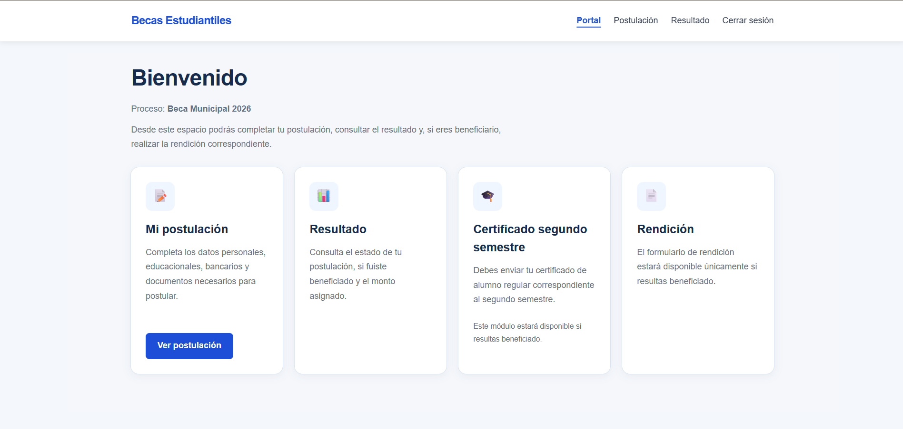

#### Postulación

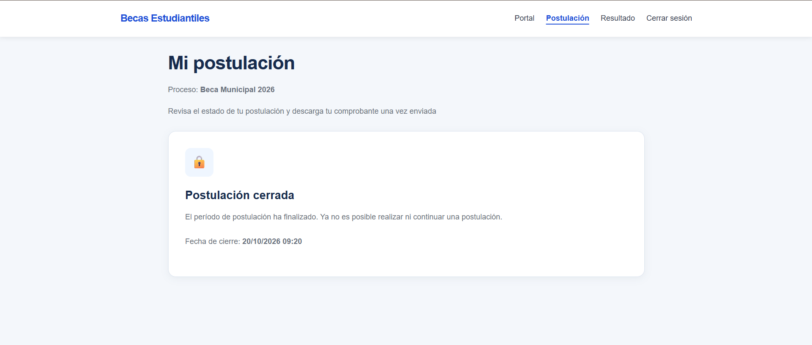

#### Resultado

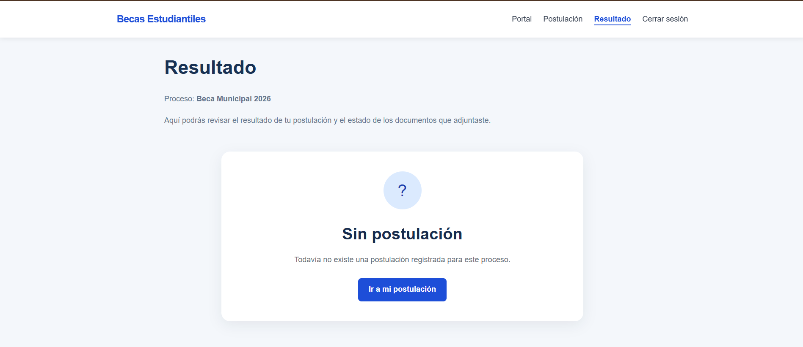

### Administrador

#### Inicio — parte 1

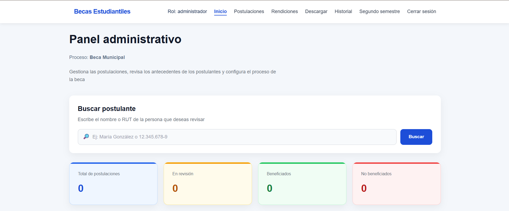

#### Inicio — parte 2

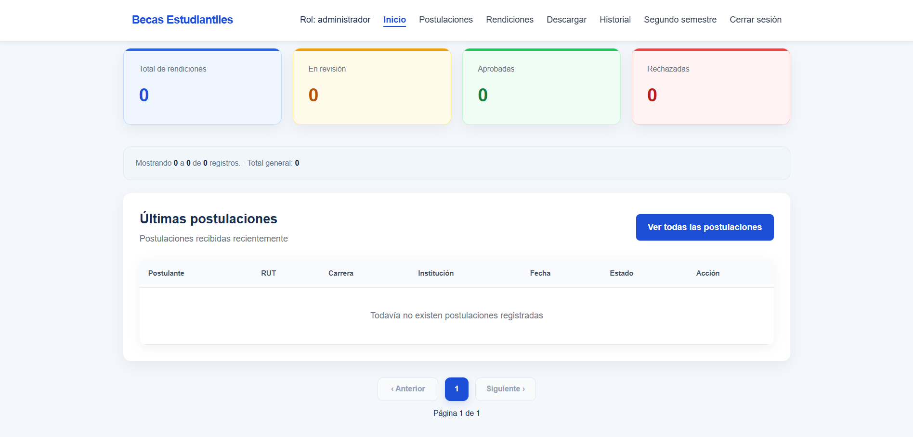

#### Postulaciones

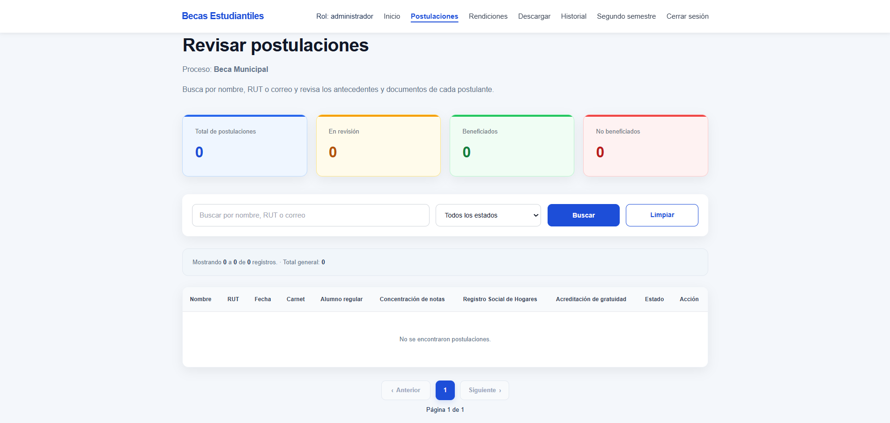

#### Rendiciones

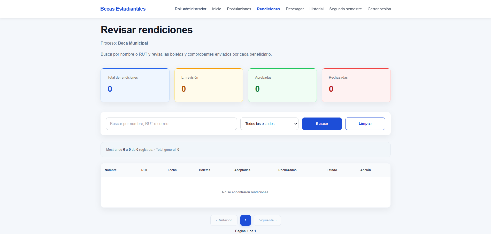

#### Segundo semestre

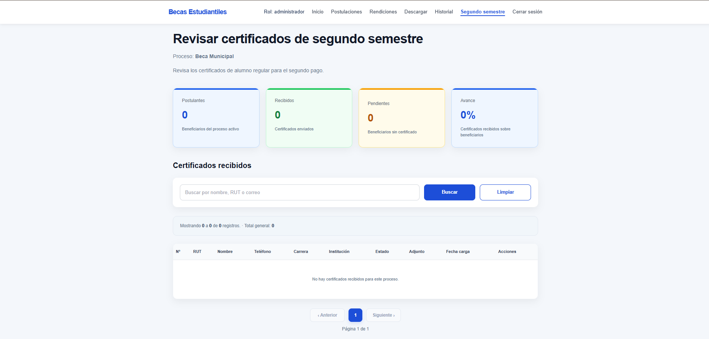

#### Archivos para descargar

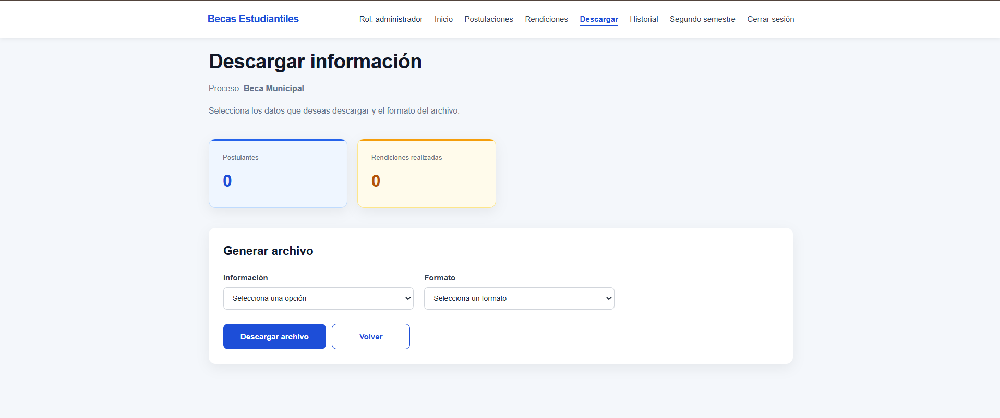

#### Historial — parte 1

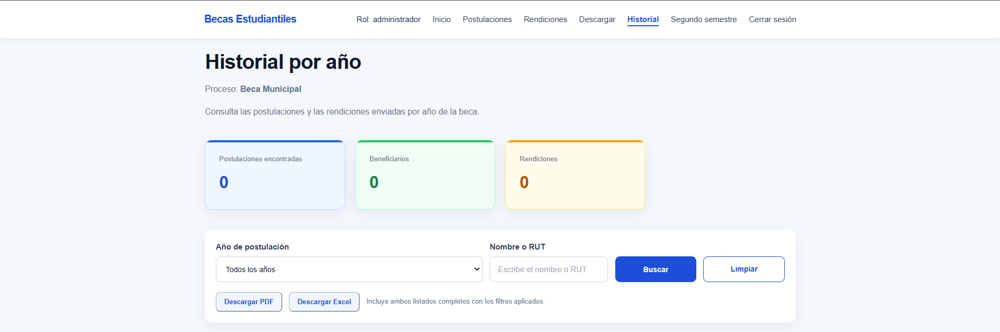

#### Historial — parte 2

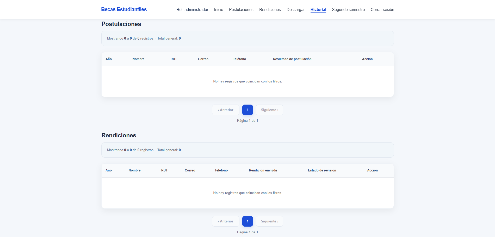

### Superior

#### Configuración de procesos

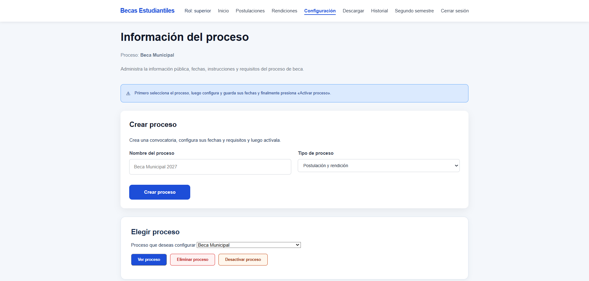
